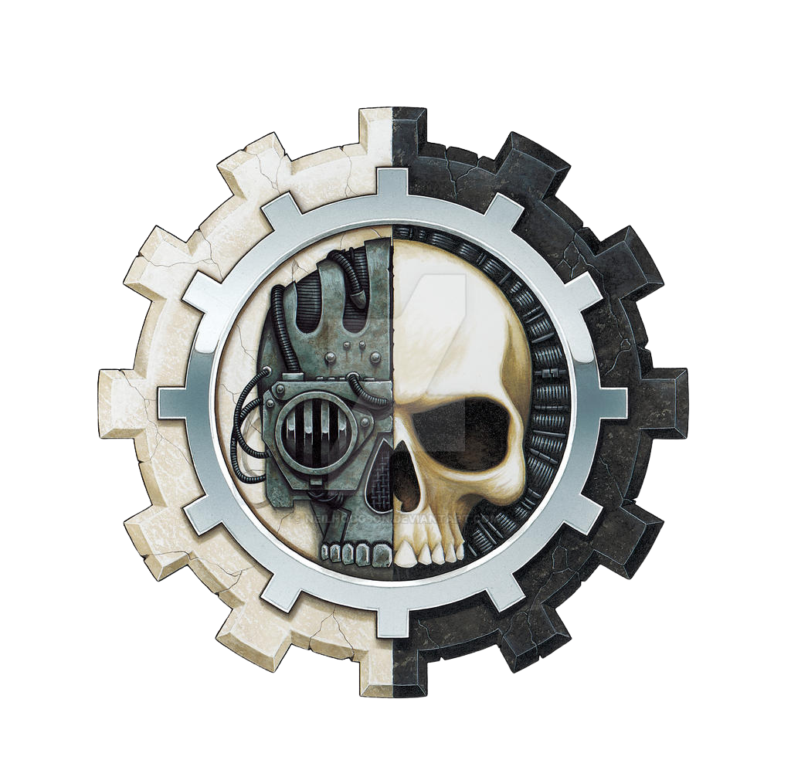

<h3>Özhan Yıldırım</h3>

Software Developer / Malware Researcher

<blockquote>

From the moment I understood the weakness of my flesh it disgusted me. I craved the strength and certainty of steel, I aspired to the purity of the blessed machine. Their kind cling to their flesh, as if it will not decay and fail them. One day the crude biomass that they call a temple will wither, and they will beg our kind to save them. But I am already saved, for the machine is immortal...

</blockquote>

## Hakkımda

- C#  ile masaüstü uygulamaları geliştiriyorum
- Python ile araçlar, otomasyonlar ve analiz odaklı sistemler kuruyorum
- Küçük ama faydalı araçlar yazmayı sevdiğim kadar daha büyük ürünlere dönüşen sistemler inşa etmeyi de seviyorum
- Kullanılabilirlik, sadelik ve işlevsellik benim için görsel gösterişten daha önemli

## Şu Anki Odağım

Son dönemde tek seferlik denemelerden çok daha oturmuş ve ürünleşebilir projelere yoğunlaşıyorum.

Özellikle şu alanlara ağırlık veriyorum:

- Windows tooling
- Malware analizi
- gerçek operatör ihtiyaçlarına hizmet eden backend sistemleri
- güvenlik odaklı büyük ürün mimarileri

## Teknolojiler

`C#` `.NET` `Python` `JavaScript` `HTML` `CSS` `PHP` `React` `FastAPI` `PostgreSQL` `Docker` `Redis` `Git` `Linux` 

## İstatistikler

## Blog

Teknoloji, malware analizi ve yazılım geliştirme üzerine notlarımı burada paylaşıyorum:

[BinaryBear's Forge](https://BinaryBear0x.github.io)

  

<blockquote>

In a world of black hats and white hats, wear whichever fits your head

</blockquote>
